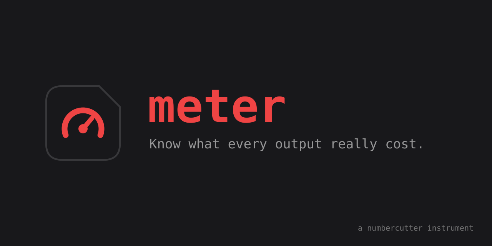

# meter

Know what every output really cost.

meter logs every model call in a generative pipeline, including the failures, retries and drafts you threw away, and marks the outputs you kept. Its report divides all of that spend by what you kept, so you see the price of a usable result instead of the price of one call.

## Quick start

No API keys. The example simulates three days of a pipeline with overloaded APIs, retries and a critic that rejects most drafts.

```sh
git clone https://github.com/numbercutter/meter && cd meter
bun examples/pipeline.ts
bun src/cli.ts report --by day --log examples/out/meter.jsonl
```

```
tag           calls  failed    spend  kept  cost/kept  wasted
------------  -----  ------  -------  ----  ---------  ------
teaser            6       1    $4.00     3      $1.33     40%
product-shot    149      23    $1.93    18    $0.1074     57%
caption          18       0  $0.0014    14    $0.0001     23%

One image lists at $0.042. One kept product shot really cost $0.1074.
```

Requires [Bun](https://bun.sh) 1.1 or later. No dependencies.

## Usage

```ts
import { createMeter } from "@numbercutter/meter";

const meter = createMeter({ log: "meter.jsonl" });

const res = await meter.fetch(
  "https://api.anthropic.com/v1/messages",
  { method: "POST", headers, body: JSON.stringify({ model: "claude-sonnet-5-5", max_tokens: 1024, messages }) },
  { tag: "product-shot", outputId: "shot-42" },
);

meter.record({
  provider: "fal",
  model: "my-video-model",
  usage: { seconds: 8 },
  tag: "teaser",
  ok: true,
  outputId: "teaser-7",
});

meter.keep("product-shot", "shot-42");
```

- `meter.fetch(url, init, { tag, outputId?, provider?, model? })` calls `fetch`, returns the untouched `Response`, and logs the call. It reads usage from OpenAI Chat Completions, OpenAI Responses, OpenAI Images, Anthropic Messages, and any JSON body with `usage.input_tokens` / `output_tokens`. Non-2xx responses and thrown network errors are logged as failed.
- `meter.record({ provider, model, usage, tag, ok, outputId?, cost? })` logs a call you measured yourself. `usage` takes `input_tokens`, `output_tokens`, `cache_read_tokens`, `cache_write_tokens`, `images` and `seconds`. Pass `cost` to skip the price table.
- `meter.keep(tag, outputId)` marks an output as kept. Anything never kept counts as discarded.
- `import { meter } from "@numbercutter/meter"` gives a shared instance that logs to `$METER_LOG` or `./meter.jsonl`.

Give every call in one attempt the same `outputId` (prompt, render, critic) and give a retry from scratch a new one. That is what lets the report say how much of the spend went to outputs you threw away.

### Report

```sh
meter report --by tag|model|day [--log meter.jsonl] [--prices overrides.json] [--since 2026-11-01] [--tag name] [--json]
meter prices [provider/model]
```

| column | meaning |
|---|---|
| `spend` | Cost of every call in the group, successful or not. |
| `failed` | Calls that errored or returned non-2xx. |
| `kept` | Distinct outputs marked with `keep`. |
| `cost/kept` | `spend / kept`. The number to watch. |
| `wasted` | Share of spend on calls whose `outputId` was never kept. `-` when calls carry no `outputId`. |

By `model` and `day`, an output counts as kept for a group when one of that group's calls produced it.

### Prices

`prices.json` holds USD per million input and output tokens, cache read and write rates, and per-image and per-second rates for media. It has an `asOf` date, and some entries carry their own. **Prices change. Check each one you rely on against the provider's pricing page.** Override or add models without editing the file:

```ts
createMeter({ prices: { "openai/sora-2": { second: 0.3 }, "acme/upscaler-v2": { image: 0.01 } } });
```

```sh
meter report --prices examples/prices.override.json
```

Model ids match exactly first, then by the longest prefix, so `openai/gpt-4o-mini-2024-07-18` uses `openai/gpt-4o-mini`. The report re-prices logged usage with the current table, so fixing a price fixes old reports too. Calls with no matching price are left out of spend and listed under the table.

## How it works

Each call and each keep is one line in an append-only JSONL file. The report reads the whole file, prices each call from its usage, groups calls, and joins keeps by `(tag, outputId)`. There is no server or database.

## Limits

- Streaming responses are logged with no usage, because the body is not read. Use `record` with the final usage from the stream.
- Tiered prices (long-context rates, batch discounts, image quality and size tiers, regional rates) are not modelled. Set an override or pass `cost`.
- A failed call that the provider still bills shows as $0 unless its body reports usage.
- The log is a plain file written with synchronous appends. Many processes writing the same file at once can interleave lines.
- The report loads the whole log into memory.
- The bundled prices are a place to start, not a source of truth.

<sub>A numbercutter instrument · MIT</sub>
